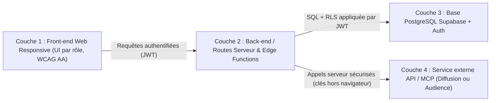
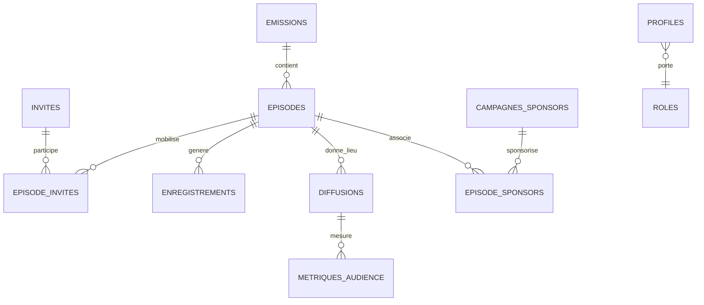

# Architecture Technique — Onde Libre Studio (Jalon 1)

> **Statut** : Livrable Étape 1 / **Jalon 1** (C14) — Cadrage technique verrouillé avant développement.  
> **Références** : `_ressources/SYNTHESE_SUJET.md`, `_ressources/SYNTHESE_COURS.md`, `docs/note-cadrage-direction.md`.

---

## 1. Vue d'ensemble & Architecture en 4 couches

L'application centralise le pilotage éditorial, les invités, la diffusion et les campagnes sponsors d'Onde Libre Studio sur une base relationnelle unique sécurisée par rôles.  
**Environnement de réalisation** *(accord pédagogique validé)* : **Google Antigravity** (IDE agentique) propulsé par **Gemini** avec mémoire projet `GEMINI.md`, en substitution de Claude Code et Claude Design tout en conservant les mêmes exigences méthodologiques et RNCP.



- **Couche 1 — Front-end** : interfaces adaptées aux 3 rôles (`production`, `diffusion`, `direction`), validation de saisie, gestion visuelle des états (chargement, vide, erreur + repli).
- **Couche 2 — Back-end / Serveur** : orchestration des appels vers le service externe, validation des payloads JSON, gestion des secrets hors navigateur, règles métier transverses.
- **Couche 3 — Base de données & Auth (Supabase)** : stockage PostgreSQL relationnel, authentification par compte (`auth.users`), autorisations appliquées au niveau ligne par **Row Level Security (RLS)**.
- **Couche 4 — API / Connecteur externe (MCP ou REST)** : rapatriement périodique ou déclenché des données de diffusion / audience avec mise en cache en base.

---

## 2. Périmètre v1 (Dans v1 / Hors v1)

| Dans la v1 (livrable certification) | Hors v1 (différé explicitement) |
|---|---|
| Référentiel unique des émissions (7 existantes + 3 de la rentrée) | Portail externe en libre-service pour les sponsors/annonceurs |
| Gestion complète du pipeline éditorial d'épisode (5 statuts) | Studio de montage audio ou hébergement des fichiers audio lourds |
| Fiches invités + suivi de contact + historique multi-épisodes | Facturation, comptabilité et gestion RH/paie des freelances |
| Suivi des enregistrements, diffusions multi-plateformes et campagnes sponsors (en base) | Publication automatique multi-plateformes en écriture si API limitée à la lecture |
| Authentification par compte et séparation stricte par 3 rôles (RLS) | Notifications push mobiles natives |
| 1 intégration externe active (audience/diffusion) + gestion d'erreurs | Agrégation simultanée de toutes les régies/plateformes en v1 |

---

## 3. Modèle de données relationnel prévu (C10)

### 3.1 Schéma conceptuel & relations



*(Note : en base Supabase, le rôle est porté par une colonne contrainte sur `profiles` liée à `auth.users` — aucun besoin de table `ROLES` séparée si énumération stricte.)*

### 3.2 Dictionnaire des tables & contraintes d'intégrité

| Table | Champs principaux (types PostgreSQL) | Clés, cardinalités & contraintes anti-doublons |
|---|---|---|
| `profiles` | `id` (`uuid` PK, FK → `auth.users.id`), `nom_complet` (`text`), `email` (`text`), `role` (`text`), `created_at` (`timestamptz`) | `CHECK (role IN ('production', 'diffusion', 'direction'))`, `UNIQUE (email)`. |
| `emissions` | `id` (`uuid` PK), `titre` (`text` NOT NULL), `thematique` (`text`), `type_emission` (`text`: original/marque), `statut` (`text`), `created_at` (`timestamptz`) | `UNIQUE (titre)`, `CHECK (type_emission IN ('original', 'marque'))`. |
| `episodes` | `id` (`uuid` PK), `emission_id` (`uuid` FK → `emissions`), `numero_episode` (`int`), `titre` (`text` NOT NULL), `statut` (`text` NOT NULL), `date_cible_publication` (`date`), `responsable_id` (`uuid` FK → `profiles`), `notes_blocage` (`text`), `updated_at` (`timestamptz`) | **1:N** depuis `emissions`. `UNIQUE (emission_id, numero_episode)`. **Pipeline strict** : `CHECK (statut IN ('idee', 'invite_confirme', 'enregistre', 'monte', 'publie'))`. |
| `invites` | `id` (`uuid` PK), `nom_complet` (`text` NOT NULL), `email` (`text`), `telephone` (`text`), `organisation` (`text`), `canal_contact` (`text`), `notes` (`text`), `created_at` (`timestamptz`) | `UNIQUE (email)` (si renseigné, empêche les fiches doublons). Coordonnées (`email`, `telephone`) classées **sensibles**. |
| `episode_invites` | `id` (`uuid` PK), `episode_id` (`uuid` FK → `episodes` ON DELETE CASCADE), `invite_id` (`uuid` FK → `invites` ON DELETE RESTRICT), `statut_invitation` (`text`), `date_confirmation` (`timestamptz`) | **Table de jonction N:N** (`episodes` ↔ `invites`). `UNIQUE (episode_id, invite_id)` interdit d'associer deux fois le même invité au même épisode. |
| `enregistrements` | `id` (`uuid` PK), `episode_id` (`uuid` FK → `episodes` ON DELETE CASCADE), `date_session` (`timestamptz` NOT NULL), `lieu_ou_lien` (`text`), `realisateur_id` (`uuid` FK → `profiles`), `statut_audio` (`text`), `duree_minutes` (`int`) | **1:N** depuis `episodes` (permet plusieurs prises/sessions). `CHECK (duree_minutes > 0)`. |
| `diffusions` | `id` (`uuid` PK), `episode_id` (`uuid` FK → `episodes` ON DELETE CASCADE), `plateforme` (`text` NOT NULL), `url_externe` (`text`), `guid_externe` (`text`), `date_publication` (`timestamptz`), `statut_diffusion` (`text`) | **1:N** depuis `episodes` (multi-plateformes). `UNIQUE (episode_id, plateforme)` empêche les doublons par plateforme. |
| `campagnes_sponsors` | `id` (`uuid` PK), `annonceur` (`text` NOT NULL), `nom_campagne` (`text` NOT NULL), `perimetre` (`text`), `budget_euros` (`numeric(10,2)`), `date_debut` (`date`), `date_fin` (`date`), `statut` (`text`) | Données financières/contractuelles **sensibles** réservées au rôle `direction` (+ préparation espace partenaires). `CHECK (date_fin >= date_debut)`. |
| `episode_sponsors` | `id` (`uuid` PK), `campagne_id` (`uuid` FK → `campagnes_sponsors` ON DELETE CASCADE), `episode_id` (`uuid` FK → `episodes` ON DELETE CASCADE), `emplacement` (`text`: pre_roll/mid_roll/post_roll) | **Table de jonction N:N** reliant campagnes sponsors et épisodes diffusés. `UNIQUE (campagne_id, episode_id)`. |
| `metriques_audience` | `id` (`uuid` PK), `diffusion_id` (`uuid` FK → `diffusions` ON DELETE CASCADE), `source_api` (`text` NOT NULL), `ecoutes_total` (`int`), `payload_brut` (`jsonb`), `statut_synchro` (`text`: ok/erreur/cache), `message_erreur` (`text`), `synced_at` (`timestamptz` NOT NULL) | Stocke les données rapatriées par l'API externe et assure le **repli en cache** en cas de panne API sans ralentir l'UI. |

---

## 4. Rôles, Authentification & Politiques RLS prévues (C13)

### 4.1 Classification des données & règles de confidentialité
- **Données internes non sensibles** : liste des émissions, titres et statuts d'épisodes, planning d'enregistrement, statut de diffusion, agrégats d'audience.
- **Données personnelles sensibles** : `invites.email`, `invites.telephone`, `invites.notes` privées (finalité : programmation éditoriale ; accès restreint ; purge/anonymisation prévue après inactivité prolongée ou sur demande RGPD).
- **Données commerciales sensibles** : `campagnes_sponsors` (`budget_euros`, `perimetre`, conditions annonceurs).
- **Secrets techniques** : clés API externes, `SUPABASE_SERVICE_ROLE_KEY` — **strictement côté serveur / variables d'environnement**, jamais exposées dans le bundle front-end.

### 4.2 Matrice des droits par profil (RLS en base Supabase)

| Entité / Ressource | `production` | `diffusion` | `direction` (Camille) |
|---|---|---|---|
| `emissions` | Lecture / Création / Modif | Lecture | Lecture / Création / Modif / Suppression |
| `episodes` | Lecture / Création / Modif (pipeline) | Lecture / Modif (passage `monte` → `publie` + champs diffusion) | Lecture / Création / Modif / Suppression |
| `invites` (fiche + coordonnées) | **Lecture / Création / Modif** | **Accès refusé** sur coordonnées sensibles (`email`, `telephone`) via vue/RLS | **Lecture / Création / Modif / Suppression** |
| `episode_invites` | Lecture / Création / Modif / Suppression | Lecture seule (noms publics d'invités pour publication) | Lecture / Création / Modif / Suppression |
| `enregistrements` | Lecture / Création / Modif | Lecture seule | Lecture / Création / Modif / Suppression |
| `diffusions` & `metriques_audience` | Lecture seule | **Lecture / Création / Modif / Synchro API** | Lecture / Création / Modif / Suppression |
| `campagnes_sponsors` & `episode_sponsors` | **Aucun accès (refus RLS)** | **Aucun accès (refus RLS)** | **Lecture / Création / Modif / Suppression** |

- **Principe de mise en œuvre** : une fonction SQL `public.current_user_role()` lit le rôle depuis `profiles` pour `auth.uid()`. Chaque table active `ALTER TABLE ... ENABLE ROW LEVEL SECURITY;`.
- **Test de validation obligatoire (Jalon 3)** : un utilisateur connecté avec le rôle `diffusion` qui interroge `campagnes_sponsors` (ou tente une lecture/écriture hors périmètre via l'API Supabase) obtient 0 ligne / erreur de permission `42501` RLS.

---

## 5. Interfaces clés prévues (C9)

L'application livrera au minimum **3 écrans métier connectés** (+ écran de connexion Supabase Auth), conçus avec un Design System structuré (tokens initialisés via **TweakCN** et maquettes/prototypes interactifs réalisés avec **Gemini** dans **Google Antigravity**, en substitution validée de Claude Design) :
1. **Écran Gestion des Épisodes & Pipeline** : vue Kanban/liste par les 5 statuts (`idée` → `publié`), changement de statut fluide, indicateurs visuels **couleur + icône + libellé** (WCAG AA) distinguant ce qui avance de ce qui bloque (`notes_blocage`), actions conditionnées au rôle.
2. **Écran Gestion des Invités** : annuaire filtrable (visible selon rôle), fiche détaillée (coordonnées protégées, canal de contact) et **historique complet de participation aux épisodes**.
3. **Vue de Pilotage Direction** : tableau de bord synthétique pour Camille (compteurs par statut, épisodes en cours, à venir, publiés, derniers chiffres d'audience consolidés, accès au suivi des campagnes sponsors).

**Exigences Design & Accessibilité** : approche mobile-first, contraste AA (≥ 4.5:1), texte base 16 px, zones interactives ≥ 24×24 px, focus clavier visible, gestion explicite des états vide / chargement / erreur.

---

## 6. Stratégie d'intégration externe & gestion d'erreurs (C11, C12)

### 6.1 Options comparées (décision arrêtée avant l'Étape 5)

| Option | Données récupérables | Avantages | Limites / Contraintes |
|---|---|---|---|
| **Flux RSS Podcast (Apple Podcasts / hébergeur)** | Métadonnées épisodes publiés, dates, durées, URLs audio, identifiants GUID | Standard ouvert, zéro clé secrète requise, fiable pour vérifier les diffusions réelles | Ne fournit pas de compteurs d'écoutes (audience) |
| **Spotify Web API (Show/Episodes)** | Métadonnées show & épisodes sur Spotify, dates de sortie, aperçus, liens externes | API REST JSON officielle documentée, OAuth client credentials | Pas de statistiques d'écoute détaillées dans l'API publique standard |
| **Ausha API / Connecteur MCP dédié** | Métadonnées + statistiques d'audience (selon plan/accès) | Couvre directement diffusion + chiffres d'écoutes | Nécessite un compte/accès API partenaire actif |

*Décision d'architecture* : quel que soit le service retenu à l'Étape 5, **tous les appels externes sont exécutés côté serveur** (route API / Edge Function) pour protéger les credentials et normaliser le JSON avant écriture dans `metriques_audience`. L'UI lit la base locale (`metriques_audience`) pour garantir des temps de réponse rapides et déclenche une synchronisation à la demande ou planifiée.

### 6.2 Gestion obligatoire des 3 cas d'erreur

| Cas d'erreur | Détection côté serveur | Message UI affiché | Solution de repli (Fallback) |
|---|---|---|---|
| **Service indisponible** (timeout, HTTP `5xx`, réseau coupé) | Timeout (ex. 5 s) ou code HTTP ≥ 500 / exception réseau | Bannière claire : *« Service externe temporairement indisponible. Données en cache affichées (dernière synchro : …). »* | Affichage des dernières données valides stockées dans `metriques_audience` + journalisation de l'erreur. |
| **Réponse vide** (HTTP `200`, tableau vide ou flux sans item) | Vérification taille `items.length === 0` ou corps vide | Message neutre : *« Aucune donnée disponible pour le moment auprès du service externe. »* | Conservation de l'existant sans écraser les données déjà enregistrées en base. |
| **Données invalides** (JSON/XML malformé, champs requis manquants, mauvais type) | Validation stricte de schéma avant insertion | Alerte non bloquante : *« Réponse externe invalide détectée ; les données existantes ont été préservées. »* | Rejet de la mise à jour, conservation du dernier état sain, trace écrite dans `statut_synchro = 'erreur'`. |

---

## 7. Arborescence cible & conventions

```text
Formation Cube/
├── GEMINI.md                        # Mémoire projet lue automatiquement par Google Antigravity / Gemini (< 200 lignes)
├── README.md                        # Présentation, installation, lancement (Étape 6)
├── CHANGELOG.md                     # Journal des modifications (Étape 6)
├── .env.example                     # Modèle des variables d'environnement (sans secrets)
├── .gitignore                       # Inclut _*, .env*, node_modules
├── _ressources/                     # Synthèses et PDFs de cours (ignorés par Git)
├── docs/
│   ├── architecture.md              # Ce document (Jalon 1)
│   ├── note-cadrage-direction.md    # Note non technique pour Camille (Jalon 1)
│   ├── dossier-rncp-brouillon.md    # Brouillon continu des 4 questions RNCP
│   ├── guide-utilisation.md         # Guides par rôle (Étape 6)
│   ├── depannage.md                 # Procédures de dépannage (Étape 6)
│   └── preuves/                     # Captures et logs de preuve par étape/jalon
├── supabase/
│   └── migrations/                  # Schémas SQL, contraintes et RLS versionnés (Étape 2+)
└── src/                             # Code applicatif (à partir de l'Étape 3 uniquement)
```

- **Conventions Git** : commits atomiques en français ou Conventional Commits (`docs:`, `feat:`, `fix:`, `chore:`, `sec:`), jamais de secret commité.
- **Harness Engineering** : à chaque étape, vérifier des cas observables précis (contraintes SQL anti-doublons à l'Étape 2, changement de statut UI à l'Étape 3, test d'accès refusé `diffusion` → `campagnes_sponsors` au Jalon 3, simulation des 3 pannes API à l'Étape 5).
